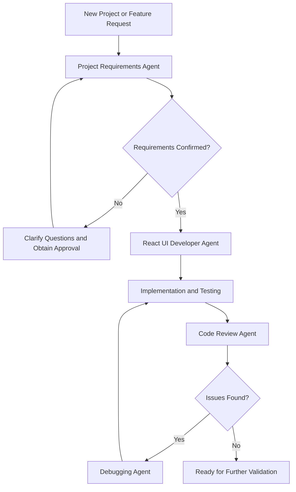

# 🤖 Agents_SN — AI-Powered Developer Workflow Toolkit

<p align="center">
  <strong>Understand requirements. Build better UIs. Debug faster. Review smarter.</strong>
</p>

<p align="center">
  <a href="https://github.com/Satyam-Nayak/agents_SN">
    
  </a>
  
  
  
</p>

## 🌟 About the Project

**Agents_SN** is an evolving collection of AI agent instructions designed to make software development more structured, efficient, and developer-friendly.

Modern development isn't just about writing code. Before implementation begins, developers need to understand requirements, confirm technology decisions, identify design expectations, investigate errors, and ensure that their code is maintainable.

Agents_SN aims to simplify these activities through specialized AI agents that follow defined roles, workflows, rules, and output formats.

Instead of approaching every task with a generic AI assistant, developers can use focused agents for specific stages of the software development lifecycle.

**The vision:** Build a reusable collection of AI agents that helps developers move from unclear requirements to better implementation, debugging, and code quality.

## 🎯 The Problem We're Solving

Software development can become inefficient when:

- Requirements are incomplete or unclear.
- Technology choices have not been confirmed.
- UI implementation starts without approved designs.
- Debugging involves guesswork rather than evidence.
- Code reviews miss important issues.
- Developers repeatedly explain the same project conventions to AI assistants.

Agents_SN addresses these challenges by organizing reusable instructions into specialized agents with clearly defined responsibilities.

## 🚀 Meet the Agents

The project currently focuses on four core development agents.

### 1. 📋 Project Requirements Agent

**Purpose:** Turn an unclear project request into a structured development plan.

This agent helps identify what needs to be understood and confirmed before development begins.

**Key responsibilities:**
- Summarize project objectives and requirements.
- Identify pages, features, and reusable components.
- Separate confirmed decisions from assumptions and unknowns.
- Recommend suitable technologies while identifying decisions requiring approval.
- Prepare questions for managers or stakeholders.
- Identify design, API, accessibility, and testing requirements.

**Expected outcome:** A clear requirements summary and approval checklist before implementation.

### 2. ⚛️ React UI Developer Agent

**Purpose:** Plan and implement React interfaces according to approved requirements.

This agent follows the existing project's architecture and technology choices instead of assuming every project needs the same setup.

**Key responsibilities:**
- Inspect the existing project structure and configuration.
- Identify the JavaScript or TypeScript setup.
- Plan reusable React components and page layouts.
- Follow the project's existing styling conventions.
- Support responsive UI development and accessibility.
- Identify API integration requirements and application states.
- Recommend appropriate testing and verification steps.

**Expected outcome:** A structured, maintainable implementation aligned with the project's requirements.

### 3. 🐛 Debugging Agent

**Purpose:** Investigate errors systematically and recommend safe, focused fixes.

Rather than immediately changing code, this agent works toward identifying the underlying cause of a problem.

**Key responsibilities:**
- Analyze error messages and relevant source files.
- Investigate React rendering and JavaScript or TypeScript errors.
- Diagnose build, dependency, routing, and API integration problems.
- Distinguish verified causes from possible explanations.
- Recommend minimal changes.
- Explain how to verify the fix and prevent recurrence.

**Expected outcome:** A clearer understanding of the problem, its likely cause, and the steps required to resolve it.

### 4. 🔍 Code Review Agent

**Purpose:** Review code for correctness, security, maintainability, and quality.

This agent is designed to provide review findings and recommendations without modifying files unless implementation is explicitly requested.

**Key responsibilities:**
- Identify bugs and incorrect behavior.
- Review security and privacy risks.
- Check consistency with project requirements.
- Evaluate React and JavaScript or TypeScript conventions.
- Review accessibility, responsive behavior, and error handling.
- Identify unnecessary duplication and maintainability concerns.
- Prioritize findings by severity and suggest practical fixes.

**Expected outcome:** Actionable review feedback before merging or committing code.

## 🧩 How the Agents Work Together

The agents are designed to support different stages of a development workflow.



This diagram represents the intended workflow. Individual agents can also be used independently whenever a specific task requires them.

## 🏗️ Project Structure

The core instructions and agent definitions are organized under `.github`.

```text
agents_SN/
├── README.md
└── new_agents/
    └── .github/
        ├── copilot-instructions.md
        └── agents/
            ├── project-requirements.agent.md
            ├── react-ui-developer.agent.md
            ├── debugging.agent.md
            └── code-reviewer.agent.md
```

*Note: The tree above illustrates the intended organization. Adjust it if the actual files are stored at a different level in the repository.*

### What Each File Does

| File or folder | Purpose |
|---|---|
| `README.md` | Explains the project, its agents, and how to get started. |
| `.github/copilot-instructions.md` | Defines shared development preferences and project-wide instructions. |
| `.github/agents/` | Contains specialized custom-agent definitions. |
| `project-requirements.agent.md` | Analyzes requirements and prepares approval questions. |
| `react-ui-developer.agent.md` | Guides React UI planning and implementation. |
| `debugging.agent.md` | Guides evidence-based troubleshooting. |
| `code-reviewer.agent.md` | Provides structured code review feedback. |

## 🛠️ Technology and Tools

The current approach is intentionally lightweight.

| Technology or tool | Role |
|---|---|
| Visual Studio Code | Workspace for creating and managing agent files. |
| GitHub Copilot Chat | Intended interface for using custom agents when supported by the installed environment. |
| Markdown | Format used to define agent instructions and behavior. |
| ChatGPT | Alternative interface for testing, refining, and using the instructions manually. |
| Git and GitHub | Version control and collaboration. |
| React | Primary frontend focus of the UI development agent. |

The agents are instruction files, not standalone applications. Their actual capabilities depend on the AI assistant, workspace context, and tools available when they are used.

No additional application dependencies are required merely to create or edit the Markdown files.

## ⚡ Getting Started

### Prerequisites

- Visual Studio Code or another Markdown editor.
- Access to the repository.
- GitHub Copilot Chat with custom-agent support, if you want to use the definitions directly in Copilot.
- Alternatively, access to ChatGPT to use the instructions manually.

### Step 1 — Clone the repository

```bash
git clone https://github.com/Satyam-Nayak/agents_SN.git
cd agents_SN
```

### Step 2 — Open the agent folder

Open the repository in VS Code and navigate to the directory containing the agent definitions.

If the agents are stored under `new_agents/.github/agents/`, open that folder to inspect the individual definitions.

### Step 3 — Review the shared instructions

Open:

```text
.github/copilot-instructions.md
```

Review the shared development preferences, safety rules, and project conventions.

### Step 4 — Explore the individual agents

Open the relevant `.agent.md` file and review its role, responsibilities, rules, and expected output.

Choose the agent that matches the task you want to perform.

### Step 5 — Start using an agent

If your Copilot installation supports custom agents, open Copilot Chat and select the relevant agent from the available interface.

If custom-agent selection is unavailable, copy the contents of the agent definition into ChatGPT and ask it to follow those instructions for your task.

**Important:** Agent discovery and workspace instruction behavior depend on where the files are located and how your editor is configured. Confirm that the intended agent is available before relying on it.

## 💬 Example Prompts

Try prompts like these to explore the intended behavior.

**Project Requirements Agent**
> I need to develop a new React UI page, but the manager has not confirmed the technology stack or design. Prepare the questions I need to ask before development.

**React UI Developer Agent**
> Inspect my existing React project and propose an implementation plan for a responsive dashboard using the project's current conventions. Do not modify files until I approve the plan.

**Debugging Agent**
> Analyze this error, inspect the relevant code, identify the most likely root cause, and recommend the smallest safe fix. Explain how I can verify the result.

**Code Review Agent**
> Review my current changes for bugs, security concerns, accessibility, maintainability, and consistency with project requirements. Report findings by severity without modifying any files.

## 🛡️ Development Principles

All agents are designed around a common set of principles.

- **Understand before implementing:** Inspect the available context before proposing changes.
- **Ask instead of assuming:** Clarify essential missing requirements.
- **Respect approved decisions:** Do not invent manager approvals or design specifications.
- **Prefer focused changes:** Avoid unnecessary rewrites and unrelated modifications.
- **Protect sensitive information:** Never expose API keys, passwords, or access tokens.
- **Verify results:** Recommend tests and explain how to confirm that a fix works.
- **Explain clearly:** Make technical reasoning accessible to developers at different experience levels.
- **Keep humans in control:** Require appropriate approval before risky or destructive actions.

## 🗺️ Roadmap

Agents_SN is an evolving project. Potential next steps include:

- [ ] Validate custom-agent discovery and behavior in VS Code.
- [ ] Improve documentation with real usage examples.
- [ ] Add dedicated agents for API integration and testing.
- [ ] Explore documentation-generation and refactoring agents.
- [ ] Introduce reusable workflows for common development tasks.
- [ ] Add example inputs and outputs for each agent.
- [ ] Create a testing checklist for agent instructions.
- [ ] Improve cross-project compatibility and customization.
- [ ] Document supported tools, limitations, and configuration requirements.

These are planned improvements, not claims that the features are already implemented.

## 🤝 Contributing

Ideas, improvements, and feedback are welcome.

1. Fork the repository.
2. Create a branch for your contribution.
3. Propose changes to an existing agent or add a new agent definition.
4. Test the instructions against realistic development tasks.
5. Update the documentation to reflect any new behavior.
6. Submit a pull request describing the problem, solution, and validation performed.

When creating a new agent, aim to include:

- A clear name and description.
- A focused role and responsibilities.
- A repeatable workflow.
- Explicit rules and limitations.
- A predictable output format.
- Practical examples and verification steps.

## 🔐 Security and Responsible Use

Agent instructions guide an AI assistant; they do not guarantee that every suggestion or code change is correct.

Always review generated code before integrating it into a project. Do not provide secrets unnecessarily, and avoid executing destructive commands or untrusted code without understanding the consequences.

If the repository includes a `LICENSE` file, consult it for the applicable reuse and contribution terms. Public availability on GitHub alone does not establish an open-source license.

## 📜 License

License information should be added here once the repository's actual license has been confirmed.

## 🌱 Final Thoughts

Good development starts with understanding the problem, not immediately writing code.

Agents_SN aims to make that principle easier to follow by giving AI assistants focused responsibilities, reusable instructions, and a consistent approach to software development.

**One repository. Specialized agents. A more structured development workflow.**

If you find the project useful, explore the repository, experiment with the agents, and contribute ideas that make developer workflows better.

<p align="center">
  <strong>Built to explore. Designed to assist. Evolving with every experiment.</strong>
</p>

<p align="center">
  <a href="https://github.com/Satyam-Nayak/agents_SN">Explore Agents_SN on GitHub</a>
</p>
